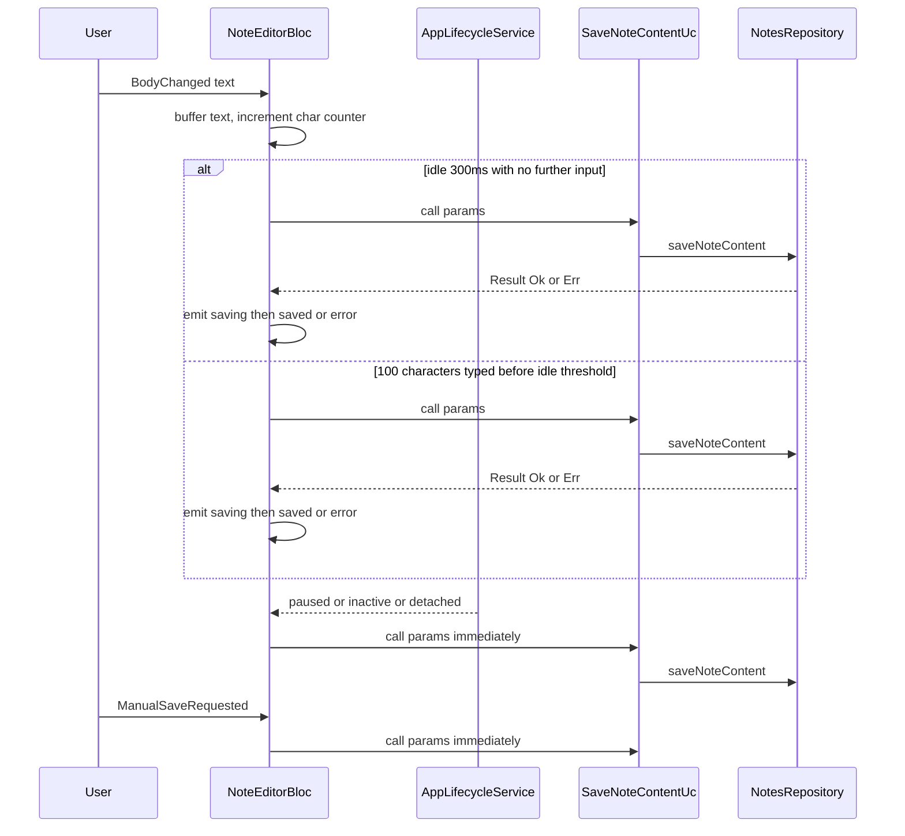
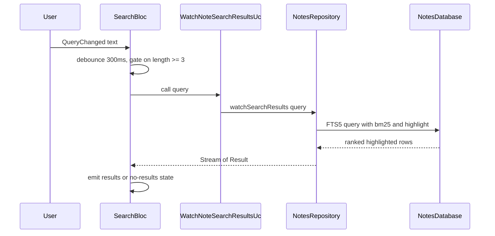
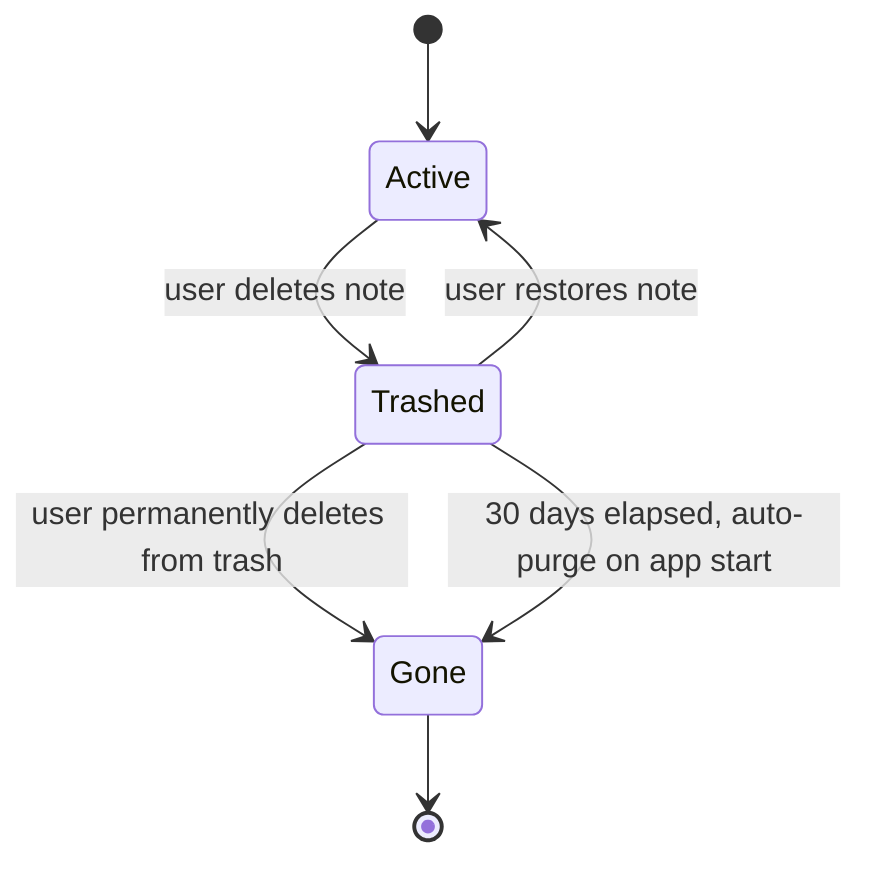

# Design Document — notes-mvp

## Overview

**Purpose**: This feature delivers the offline-first note-taking core of Knowledge Hub — fast capture, Markdown source editing with highlighted code blocks, debounced autosave with visible save status, folder/tag organization, full-text search, and a recoverable trash — to developers, students, and professionals who currently have to trade off speed, searchability, or offline reliability in existing note apps.

**Users**: All three personas use identical capture/search/organize flows (Requirement 9); persona-specific affordances (code highlighting, tag-based subject filtering) sit as additive layers on the same core.

**Impact**: Greenfield — only the default `flutter create` scaffold exists today (`lib/main.dart`, stock `pubspec.yaml`). This design introduces the first feature module (`lib/features/notes/`); two project-specific additions (`core/usecase/`'s stream variant, now formally part of `flutter-clean-architecture-guide.md` §4.4, and `core/design_system/`, this app's first typed `design.md`-token classes and reusable button/text-field primitives); and this app's first three standalone, zero-project-context local packages under `packages/` (per the guide's new §3.1 reuse convention) — a SQLite WAL+FTS5 toolkit, a Markdown code-block editor, and an app-lifecycle service — each portable to other Flutter projects unmodified.

### Goals
- Capture, edit, and persist notes with zero data loss, fully offline (Requirements 1, 3, 8).
- Organize via one folder per note and multi-tag assignment with AND/OR filtering (Requirements 4, 5, 10).
- Full-text search across title + body, ranked and highlighted, within the 100ms/10k-note budget (Requirement 6).
- Recoverable delete via a 30-day trash window (Requirement 7).
- Persona-neutral core flows (Requirement 9).

### Non-Goals
- Cross-device sync, auth, collaboration (v1.1/never — Supabase-backed, separate spec).
- AI-powered semantic search/summarization (v2.0 — separate spec).
- WYSIWYG/rendered Markdown, note linking/graph, voice capture, OCR, image generation (explicit PRD non-goals).
- Export/backup format and encryption-at-rest (explicitly deferred, tracked as a follow-up decision outside this spec).
- State management library selection (already fixed project-wide as `flutter_bloc` by `tech.md`/the Clean Architecture guide — not re-decided here).

## Boundary Commitments

### This Spec Owns
- The `Note`, `Folder`, and `Tag` domain model, their local persistence schema, and all CRUD/lifecycle operations on them (create, autosave, trash, restore, permanent delete, auto-purge).
- Full-text search (ranking + highlighting) over note title and body.
- Folder assignment (single folder per note) and tag assignment/filtering (AND/OR).
- The save-status lifecycle (not saved / saving / saved) and its autosave triggers.
- `StreamUseCase<S, P>` / `StreamUseCaseNoParams<S>` in `core/usecase/` — a project-level architecture primitive this feature requires. Owned as project-specific (not a `packages/*` candidate) because it depends on this app's own `Result`/`Failure` types; now formally documented in `flutter-clean-architecture-guide.md` §4.4 rather than merely flagged as a follow-up.
- `core/design_system/` — this app's first typed `design.md`-token classes and reusable presentational primitives (buttons, text field), introduced here because no prior feature exists to have added them. Project-specific for the same reason as `StreamUseCase` (tied to this app's own `design.md` values, not a `packages/*` candidate) — but owned as durable, cross-feature infrastructure future features are expected to reuse, not re-litigate.

### Reusable Packages Introduced (not feature-owned — see Allowed Dependencies)
Per the guide's new §3.1, this spec introduces three standalone local packages with **zero dependency on this app's types** — the app *consumes* them, it does not own their long-term maintenance boundary the way it owns `Note`/`Folder`/`Tag`:
- `packages/sqlite_wal_fts_toolkit/` — generic WAL-mode SQLite opener + FTS5 virtual-table/trigger SQL builders, parameterized only by table/column names.
- `packages/markdown_code_block_editor/` — generic fenced-code-block-aware `TextEditingController` + highlighting widget, styled via caller-supplied parameters (no baked-in `design.md` values).
- `packages/app_lifecycle_service/` — generic `WidgetsBindingObserver`-to-`Stream<AppLifecycleState>` adapter, no DI annotations.

### Out of Boundary
- Cross-device sync and authentication (v1.1, Supabase-backed) — this spec only avoids decisions that would block it (UUID note IDs, repository-pattern seam), it does not implement any part of it.
- AI semantic search, summarization, or chat (v2.0).
- Export/backup file format and encryption-at-rest — explicitly deferred; this spec must not guess a format.
- Note linking/graph between notes.
- Any UI visual pattern not covered by `design.md` (repo root) — flagged per-component below rather than invented.
- Long-term maintenance/versioning strategy for the three `packages/*` packages once other projects start consuming them (e.g. semantic versioning, changelogs) — this spec only establishes them; a multi-consumer maintenance policy is a future decision.

### Allowed Dependencies
- `packages/sqlite_wal_fts_toolkit`, `packages/markdown_code_block_editor`, `packages/app_lifecycle_service` (local `path:` dependencies) — this feature's persistence, code-editing, and lifecycle building blocks.
- `flutter_bloc` + `bloc_concurrency`, `get_it` + `injectable`, `freezed` — per existing steering (`tech.md`).
- `uuid` — client-generated note/folder/tag identifiers.
- `design.md` (repo root) tokens/components for every visual value.

### Revalidation Triggers
- Any change to the `Note`/`Folder`/`Tag` schema shape (v1.1 Supabase migration mapping depends on today's shape).
- Any change to the note ID generation strategy (must remain globally-unique UUIDs for the planned v1.1 sync migration).
- Any change to the `StreamUseCase` contract shape introduced here (other features may adopt it).
- Any change to the public API of `packages/app_lifecycle_service`, `packages/sqlite_wal_fts_toolkit`, or `packages/markdown_code_block_editor` — other future projects may depend on these packages verbatim.
- Any change to the WAL/journal mode configuration.
- Any relaxation of the "no full Markdown rendering" boundary in Requirement 2.4.
- Any change that would introduce a dependency from a `packages/*` package back onto `core/` or `features/` — this would silently break the "zero project context" guarantee the guide's §3.1 relies on.

## Architecture

### Architecture Pattern & Boundary Map

**Architecture Integration**:
- Selected pattern: Clean Architecture (domain/data/presentation, dependency rule) with `flutter_bloc`'s MVI-style Event-in/State-out presentation loop and ViewModels — per the project's binding standard (`flutter-clean-architecture-guide.md`).
- Domain/feature boundaries: one feature folder, `lib/features/notes/`, covering notes, folders, and tags as three separate repository contracts (distinct aggregates, one bounded "organization" concept) sharing one physical Drift database.
- Existing patterns preserved: `Result<Failure, S>` error handling, single-`DataSource`-contract-per-aggregate pattern, ViewModel-only widget reads, Bloc/Cubit `state`-only public surface. Each `*DataSource` abstract contract has exactly one implementation today — `*LocalDataSourceImpl` (Drift-backed), named per the guide's own §6.2 `Remote`/`Local` convention rather than a Drift-specific name, precisely so that a `*NetworkDataSourceImpl` (Supabase-backed) can be added in v1.1 implementing the *same* contract, with `*RepositoryImpl` composing both via `@Named('local')`/`@Named('remote')` exactly as the guide's own worked example shows — no rename needed when sync arrives.
- New components rationale: `StreamUseCase` (project-specific, `core/usecase/` — reactive local watches for search/filter/list, needed to hit the 50ms/100ms latency budgets without manual polling); `core/design_system/` (project-specific — the typed `design.md`-token classes and reusable button/text-field primitives the design-system steering already mandates, not yet established since this is the first feature); `packages/app_lifecycle_service` (lets `NoteEditorBloc` react to app lifecycle without ever receiving `BuildContext`, portable to other projects); `packages/sqlite_wal_fts_toolkit` (generic WAL+FTS5 setup mechanics behind `NotesDatabase`); `packages/markdown_code_block_editor` (generic fenced-code-block detection/highlighting behind `CodeBlockHighlightedTextWidget`).

```mermaid
graph TB
    subgraph Presentation
        NoteEditorBloc --> NoteEditorViewModel
        SearchBloc --> NoteSearchResultViewModel
        NoteListCubit --> NoteListItemViewModel
        FolderCubit --> FolderViewModel
        TagCubit --> TagViewModel
        TrashCubit --> TrashedNoteViewModel
    end

    subgraph Domain
        CreateNoteUc
        SaveNoteContentUc
        WatchFilteredNotesUc
        WatchNoteSearchResultsUc
        MoveNoteToTrashUc
        RestoreNoteFromTrashUc
        PermanentlyDeleteNoteUc
        PurgeExpiredTrashUc
        CreateFolderUc
        WatchFoldersUc
        DeleteFolderUc
        CreateTagUc
        WatchTagsUc
        DeleteTagUc
        NotesRepository
        FoldersRepository
        TagsRepository
    end

    subgraph Data
        NotesRepositoryImpl
        FoldersRepositoryImpl
        TagsRepositoryImpl
        NotesDataSource
        FoldersDataSource
        TagsDataSource
        NotesLocalDataSourceImpl
        FoldersLocalDataSourceImpl
        TagsLocalDataSourceImpl
        NotesDatabase
    end

    subgraph ProjectCoreAdditions
        StreamUseCaseBase
    end

    subgraph ReusablePackages
        AppLifecycleServicePkg
        SqliteWalFtsToolkit
        MarkdownCodeBlockEditor
    end

    NoteEditorBloc --> SaveNoteContentUc
    NoteEditorBloc --> AppLifecycleServicePkg
    SearchBloc --> WatchNoteSearchResultsUc
    NoteListCubit --> WatchFilteredNotesUc
    TrashCubit --> WatchFilteredNotesUc
    TrashCubit --> RestoreNoteFromTrashUc
    TrashCubit --> PermanentlyDeleteNoteUc
    FolderCubit --> WatchFoldersUc
    FolderCubit --> CreateFolderUc
    FolderCubit --> DeleteFolderUc
    TagCubit --> WatchTagsUc
    TagCubit --> CreateTagUc
    TagCubit --> DeleteTagUc

    CreateNoteUc --> NotesRepository
    SaveNoteContentUc --> NotesRepository
    WatchFilteredNotesUc --> NotesRepository
    WatchNoteSearchResultsUc --> NotesRepository
    MoveNoteToTrashUc --> NotesRepository
    RestoreNoteFromTrashUc --> NotesRepository
    PermanentlyDeleteNoteUc --> NotesRepository
    PurgeExpiredTrashUc --> NotesRepository
    CreateFolderUc --> FoldersRepository
    WatchFoldersUc --> FoldersRepository
    DeleteFolderUc --> FoldersRepository
    CreateTagUc --> TagsRepository
    WatchTagsUc --> TagsRepository
    DeleteTagUc --> TagsRepository

    NotesRepository -.implemented by.-> NotesRepositoryImpl
    FoldersRepository -.implemented by.-> FoldersRepositoryImpl
    TagsRepository -.implemented by.-> TagsRepositoryImpl

    NotesRepositoryImpl --> NotesDataSource
    FoldersRepositoryImpl --> FoldersDataSource
    TagsRepositoryImpl --> TagsDataSource

    NotesDataSource -.implemented by.-> NotesLocalDataSourceImpl
    FoldersDataSource -.implemented by.-> FoldersLocalDataSourceImpl
    TagsDataSource -.implemented by.-> TagsLocalDataSourceImpl

    NotesLocalDataSourceImpl --> NotesDatabase
    FoldersLocalDataSourceImpl --> NotesDatabase
    TagsLocalDataSourceImpl --> NotesDatabase
    NotesDatabase --> SqliteWalFtsToolkit

    WatchFilteredNotesUc -.extends.-> StreamUseCaseBase
    WatchNoteSearchResultsUc -.extends.-> StreamUseCaseBase
    WatchFoldersUc -.extends.-> StreamUseCaseBase
    WatchTagsUc -.extends.-> StreamUseCaseBase
```

- Steering compliance: no `dynamic`/`Object?`/cross-layer `Map<String, dynamic>`; Drift's generated typed rows replace what would otherwise be a JSON `Model` boundary, so no dynamic maps appear anywhere in this feature.


`MarkdownCodeBlockEditor` is consumed at the widget level (`CodeBlockHighlightedTextWidget`, Requirement 2.3/2.4), one layer below what this architecture diagram depicts — see File Structure Plan and Components and Interfaces below.

### Technology Stack

| Layer | Choice / Version | Role in Feature | Notes |
|-------|------------------|------------------|-------|
| State management | `flutter_bloc` + `bloc_concurrency` | Bloc for `NoteEditorBloc`/`SearchBloc` (need debounce transformers); Cubit for list/folder/tag/trash (simple method calls) | Fixed by steering, not decided here — `bloc_concurrency` specifically is mandated by `flutter-clean-architecture-guide.md` §7.4 ("use `on<Event>(handler, transformer: ...)` from `bloc_concurrency` for debounce/throttle/restartable semantics instead of hand-rolled Stream gymnastics"); this feature is the first to actually add it as a dependency, not a new choice made here |
| Local persistence (engine choice) | `drift` on `package:sqlite3`, WAL mode | Single on-device database for notes/folders/tags/FTS5 index | Replaces the PRD's original Hive default — see `research.md` |
| Local persistence (reusable setup) | `packages/sqlite_wal_fts_toolkit` (local path package) | WAL-mode opener + FTS5 virtual-table/trigger SQL builders, consumed by `notes_database.dart` | Zero dependency on this app's types — portable to other projects |
| Full-text search | SQLite FTS5 (external-content virtual table), `bm25()`/`highlight()` | Ranked, highlighted search over title+body | Native to Drift, no extra library |
| Code-block editing (reusable) | `packages/markdown_code_block_editor` (local path package), built on `package:highlight` directly (not `flutter_code_editor` — avoids pulling in its full editor-widget chrome, per research.md's sanctioned alternative) | Fenced-code-block-aware `TextEditingController` + highlighting widget, styled via caller-supplied parameters | Zero dependency on this app's types or `design.md` values — portable to other projects |
| App lifecycle (reusable) | `packages/app_lifecycle_service` (local path package) | `WidgetsBindingObserver` wrapped as `Stream<AppLifecycleState>`, consumed by `NoteEditorBloc` | Zero dependency on this app's types or DI annotations — portable to other projects |
| Identifiers | `uuid` (v4) | Client-generated globally-unique IDs for notes/folders/tags | Required now to not block v1.1 Supabase sync |
| DI | `get_it` + `injectable` | Wires repositories, data sources, and Blocs/Cubits (latter via `BlocProvider`, not `get_it` singletons); manually registers the three `packages/*` implementations since they carry no DI annotations themselves | Per steering |

## File Structure Plan

### Directory Structure
```
packages/
├── sqlite_wal_fts_toolkit/                     # NEW standalone package — zero dependency on knowledge_hub types
│   ├── pubspec.yaml
│   └── lib/
│       ├── sqlite_wal_fts_toolkit.dart          # barrel export
│       └── src/
│           ├── wal_mode_database_opener.dart     # opens a WAL-mode sqlite3 QueryExecutor, parameterized by file name only
│           └── fts5_virtual_table_builder.dart   # buildFts5ExternalContentTableSql() / buildFts5SyncTriggerSql(), parameterized by table/column names
├── markdown_code_block_editor/                 # NEW standalone package — zero dependency on knowledge_hub types or design.md
│   ├── pubspec.yaml
│   └── lib/
│       ├── markdown_code_block_editor.dart      # barrel export
│       └── src/
│           ├── code_block_aware_text_editing_controller.dart  # RegExp-based fenced-code-block detection, builds styled TextSpans
│           └── code_block_highlighted_text_field.dart          # widget wrapping the controller + package:highlight tokenizer; accepts caller-supplied TextStyle/theme params
└── app_lifecycle_service/                       # NEW standalone package — zero dependency on knowledge_hub types, no DI annotations
    ├── pubspec.yaml
    └── lib/
        ├── app_lifecycle_service.dart            # barrel export: abstract AppLifecycleService
        └── src/
            └── app_lifecycle_service_impl.dart    # WidgetsBindingObserver -> Stream<AppLifecycleState>

lib/
├── core/
│   ├── usecase/
│   │   └── usecase.dart                       # MODIFIED: add StreamUseCase<S,P> / StreamUseCaseNoParams<S> (see flutter-clean-architecture-guide.md §4.4)
│   ├── design_system/                          # NEW: this app's typed design.md-token classes + reusable primitives (project-specific — NOT a packages/* candidate, tied to this app's specific tokens)
│   │   ├── knowledge_hub_colors.dart            # static Color getters, 1:1 with design.md {colors.*}
│   │   ├── knowledge_hub_text_styles.dart       # static TextStyle getters, 1:1 with design.md {typography.*}
│   │   ├── knowledge_hub_spacing.dart           # static double getters, 1:1 with design.md {spacing.*}
│   │   ├── knowledge_hub_radii.dart             # static BorderRadius/double getters, 1:1 with design.md {rounded.*}
│   │   ├── knowledge_hub_elevation.dart         # the system's single shadow-tier constant, 1:1 with design.md Elevation
│   │   └── widgets/
│   │       ├── primary_button_widget.dart        # design.md {component.button-primary}
│   │       ├── secondary_button_widget.dart      # design.md {component.button-secondary}
│   │       ├── tertiary_text_button_widget.dart  # design.md {component.button-tertiary-text}
│   │       ├── circular_icon_button_widget.dart  # design.md {component.icon-button-circle}
│   │       └── app_text_field_widget.dart        # design.md {component.text-input} — the ONE text-field implementation every text input in the app uses (see Components and Interfaces)
│   └── di/
│       └── injection.dart                      # MODIFIED: manual getIt.registerLazySingleton<AppLifecycleService>(...) binding — the package carries no annotations itself
└── features/
    └── notes/
        ├── domain/
        │   ├── entities/
        │   │   ├── note.dart                         # Note (id, title, body, folderId?, tagIds, createdAt, updatedAt, deletedAt?)
        │   │   ├── folder.dart                        # Folder (id, name)
        │   │   ├── tag.dart                           # Tag (id, name)
        │   │   ├── note_search_result.dart             # Note + highlightedTitleSnippet + highlightedBodySnippet
        │   │   └── note_list_filter.dart               # NoteListFilterParams, TagFilterMode, NoteLifecycleScope
        │   ├── repositories/
        │   │   ├── notes_repository.dart
        │   │   ├── folders_repository.dart
        │   │   └── tags_repository.dart
        │   └── usecases/
        │       ├── create_note_uc.dart                 # 1.1, 1.2
        │       ├── save_note_content_uc.dart           # 3.1-3.4, 3.8
        │       ├── watch_filtered_notes_uc.dart         # 4.4, 5.2, 5.4, 5.5, 10.1
        │       ├── watch_note_search_results_uc.dart    # 6.1-6.5
        │       ├── move_note_to_trash_uc.dart           # 7.1
        │       ├── restore_note_from_trash_uc.dart      # 7.2
        │       ├── permanently_delete_note_uc.dart      # 7.3
        │       ├── purge_expired_trash_uc.dart          # 7.4
        │       ├── create_folder_uc.dart                # 4.1, 4.2
        │       ├── watch_folders_uc.dart                # 4.4
        │       ├── delete_folder_uc.dart                # 4.1 (unfile business rule)
        │       ├── create_tag_uc.dart                   # 5.1
        │       ├── watch_tags_uc.dart                   # 5.1
        │       └── delete_tag_uc.dart                   # 5.1 (untag business rule)
        ├── data/
        │   ├── local/
        │   │   └── notes_database.dart                 # @DriftDatabase: Notes, Folders, Tags, NoteTags tables + notes_fts virtual table + sync triggers, built on packages/sqlite_wal_fts_toolkit's opener + SQL builders
        │   ├── models/
        │   │   ├── note_model.dart                      # fromDriftRow() / toCompanion() / toEntity()
        │   │   ├── folder_model.dart
        │   │   ├── tag_model.dart
        │   │   └── note_search_result_model.dart
        │   ├── datasources/
        │   │   ├── notes_data_source.dart               # abstract contract — the shape any Local or (v1.1) Network implementation must satisfy
        │   │   ├── notes_local_data_source_impl.dart     # Drift-backed; named Local (not "Drift") so a notes_network_data_source_impl.dart can implement the same contract in v1.1
        │   │   ├── notes_fake_data_source.dart          # in-memory test double
        │   │   ├── folders_data_source.dart
        │   │   ├── folders_local_data_source_impl.dart
        │   │   ├── folders_fake_data_source.dart
        │   │   ├── tags_data_source.dart
        │   │   ├── tags_local_data_source_impl.dart
        │   │   └── tags_fake_data_source.dart
        │   └── repositories/
        │       ├── notes_repository_impl.dart
        │       ├── folders_repository_impl.dart
        │       └── tags_repository_impl.dart
        └── presentation/
            ├── bloc/
            │   ├── note_editor/
            │   │   ├── note_editor_bloc.dart            # 1.1-1.3, 3.1-3.8
            │   │   ├── note_editor_event.dart
            │   │   └── note_editor_state.dart
            │   └── search/
            │       ├── search_bloc.dart                 # 6.1-6.5
            │       ├── search_event.dart
            │       └── search_state.dart
            ├── cubit/
            │   ├── note_list/
            │   │   ├── note_list_cubit.dart              # 4.4, 5.2-5.5, 10.1
            │   │   └── note_list_state.dart
            │   ├── folder/
            │   │   ├── folder_cubit.dart                 # 4.1-4.3
            │   │   └── folder_state.dart
            │   ├── tag/
            │   │   ├── tag_cubit.dart                    # 5.1, 5.3
            │   │   └── tag_state.dart
            │   └── trash/
            │       ├── trash_cubit.dart                  # 7.1-7.4
            │       └── trash_state.dart
            ├── view_models/
            │   ├── note_list_item_view_model.dart
            │   ├── note_editor_view_model.dart            # title/body/folder/tags getters only — save status is which NoteEditorState subclass is active (3.5-3.7), not a field here
            │   ├── note_search_result_view_model.dart     # highlighted spans (6.4)
            │   ├── folder_view_model.dart
            │   ├── tag_view_model.dart
            │   └── trashed_note_view_model.dart           # includes daysRemainingLabel getter
            ├── pages/                                # exactly 3 pages — search is embedded in note_list_page.dart, folder/tag management are dialogs launched from it (see widgets/ below), not separate pages
            │   ├── note_list_page.dart
            │   ├── note_editor_page.dart
            │   └── trash_page.dart
            └── widgets/                              # each composes core/design_system/ primitives below — no inline TextField()/ElevatedButton()/hardcoded Color()/TextStyle() in feature code
                ├── note_list_item_widget.dart          # composes KnowledgeHubColors/TextStyles/Radii/Elevation directly (no note-specific reusable primitive needed)
                ├── save_status_indicator_widget.dart       # 3.5-3.7 — switches on NoteEditorState subtype, composes KnowledgeHubTextStyles/Colors
                ├── folder_chip_widget.dart
                ├── tag_chip_widget.dart
                ├── tag_filter_mode_toggle_widget.dart      # 5.3
                ├── search_bar_widget.dart                  # embedded within note_list_page.dart — there is no separate search page/route
                ├── folder_creation_dialog_widget.dart      # 4.1-4.3 — uses app_text_field_widget.dart for the name input, surfaces FolderCreationFailed inline; opened from note_list_page.dart, not a standalone page
                ├── tag_creation_dialog_widget.dart         # 5.1 — mirrors folder_creation_dialog_widget.dart for tags; opened from note_list_page.dart
                └── code_block_highlighted_text_widget.dart # 2.3, 2.4 — thin wrapper composing packages/markdown_code_block_editor's widget with design.md-derived TextStyle values

Note title input (inside note_editor_page.dart), folder/tag name inputs (inside folder_cubit/tag_cubit creation dialogs) each instantiate core/design_system/widgets/app_text_field_widget.dart directly with a controller + onChanged callback that dispatches the relevant Bloc/Cubit event — no feature-local TextField duplication, no widget-level knowledge of styling.

test/
├── fixtures/                                    # synthetic 10k-note dataset for performance tests
└── features/notes/                               # mirrors lib/features/notes/ 1:1

packages/*/test/                                  # each standalone package tests itself in isolation, no knowledge_hub app context
```

### Modified Files
- `flutter-clean-architecture-guide.md` (repo root) — §4.4 gains `StreamUseCase<S, P>`/`StreamUseCaseNoParams<S>`, §3.1 documents the new `packages/` reusable-package convention, §11 open item #1 marked resolved. Already actioned as part of this design revision (see `research.md`).
- `pubspec.yaml` — add local `path:` dependencies on the three new `packages/*` packages, plus `drift`, `sqlite3`, `uuid`.
- `lib/core/usecase/usecase.dart` — add `StreamUseCase<S, P>` and `StreamUseCaseNoParams<S>` alongside the four existing base classes.
- `lib/core/design_system/` — NEW: typed `design.md`-token classes (`KnowledgeHubColors`/`TextStyles`/`Spacing`/`Radii`/`Elevation`) and reusable primitives (`PrimaryButtonWidget`, `SecondaryButtonWidget`, `TertiaryTextButtonWidget`, `CircularIconButtonWidget`, `AppTextFieldWidget`) — this app's first feature establishes it; future features extend, not duplicate, it.
- `lib/core/di/injection.dart` (or equivalent `injectable` config root) — register `NotesDatabase` and the new repositories/data sources via `injectable` annotations, plus a manual `getIt.registerLazySingleton<AppLifecycleService>(() => AppLifecycleServiceImpl())` binding (the package itself carries no DI annotations).
- `lib/bootstrap.dart` — invoke `PurgeExpiredTrashUc` once after DI configuration, fire-and-forget (Requirement 7.4's auto-purge check runs opportunistically at cold start; Phase 1 has no background-execution infrastructure for a true recurring timer).

## System Flows

### Autosave Flow (Requirement 3)

Key decisions not obvious from the diagram: the 300ms-idle path and the 100-char path are both handled inside the same handler via a plain, handler-owned `Timer` (cancel-and-restart on every keystroke) rather than a `bloc_concurrency`/`stream_transform` event-transformer — see the "NoteEditorBloc" §"State Management" amendment (2026-09-19) for why a transformer-level debounce can't support the early-bypass requirement — both paths converge on the same `SaveNoteContentUc` call.

### Search Flow (Requirement 6)


### Trash Lifecycle (Requirement 7)


## Requirements Traceability

| Requirement | Summary | Components | Interfaces | Flows |
|-------------|---------|------------|------------|-------|
| 1.1, 1.2 | Fast capture, 3 taps / 2s | NoteListPage, NoteEditorBloc, CreateNoteUc | `CreateNoteUc.call()` | — |
| 1.3 | Cold start ≤2s | App bootstrap | — | — |
| 2.1, 2.2 | Title + body fields, source editing | NoteEditorPage, NoteEditorBloc, NoteEditorViewModel | — | — |
| 2.3, 2.4 | Fenced code-block highlighting only | CodeBlockHighlightedTextWidget | — | — |
| 3.1-3.4, 3.8 | Debounce/char-count/lifecycle/manual save, zero data loss | NoteEditorBloc, AppLifecycleService, SaveNoteContentUc, NotesRepository | `SaveNoteContentUc.call(SaveNoteContentParams)` | Autosave Flow |
| 3.5-3.7 | Save status indicator | `NoteEditorState` subclasses (`NotSaved`/`Saving`/`Saved`), SaveStatusIndicatorWidget | — | Autosave Flow |
| 4.1-4.3 | Folder assignment (single, flat) | FolderCubit, CreateFolderUc, Folder entity, Notes schema (`folderId`) | `CreateFolderUc.call(String)` | — |
| 4.4 | Folder filter | NoteListCubit, WatchFilteredNotesUc | `WatchFilteredNotesUc.call(NoteListFilterParams)` | — |
| 5.1 | Tag assignment | TagCubit, CreateTagUc, Tag entity, NoteTags join table | `CreateTagUc.call(String)` | — |
| 5.2 | Tag filter ≤50ms | NoteListCubit, WatchFilteredNotesUc | `WatchFilteredNotesUc.call(NoteListFilterParams)` | — |
| 5.3-5.5 | AND/OR tag filter toggle | TagFilterModeToggleWidget, NoteListCubit, `TagFilterMode` | — | — |
| 6.1 | Live search, 3-char/300ms gate | SearchBloc | — | Search Flow |
| 6.2, 6.3 | Title+body search, ≤100ms/10k notes | NotesDatabase (FTS5), WatchNoteSearchResultsUc | `WatchNoteSearchResultsUc.call(String)` | Search Flow |
| 6.4 | Highlighted matches | NoteSearchResultViewModel, NoteSearchResultModel | — | Search Flow |
| 6.5 | No-results state | SearchBloc, SearchState | — | Search Flow |
| 7.1 | Soft delete to trash | TrashCubit, MoveNoteToTrashUc | `MoveNoteToTrashUc.call(String)` | Trash Lifecycle |
| 7.2 | Restore from trash | TrashCubit, RestoreNoteFromTrashUc | `RestoreNoteFromTrashUc.call(String)` | Trash Lifecycle |
| 7.3 | Permanent delete from trash | TrashCubit, PermanentlyDeleteNoteUc | `PermanentlyDeleteNoteUc.call(String)` | Trash Lifecycle |
| 7.4 | 30-day auto-purge | Bootstrap, PurgeExpiredTrashUc | `PurgeExpiredTrashUc.call()` | Trash Lifecycle |
| 8.1, 8.2 | Full offline functionality, no network UI | All of the above (no network dependency anywhere in this feature) | — | — |
| 9.1, 9.2 | Persona-neutral core flows | NoteListPage, NoteEditorPage (single shared flow for all personas) | — | — |
| 10.1 | Default sort: last-modified desc | WatchFilteredNotesUc / NotesRepositoryImpl (applied unconditionally) | `WatchFilteredNotesUc.call(NoteListFilterParams)` | — |

## Components and Interfaces

### Summary

| Component | Domain/Layer | Intent | Req Coverage | Key Dependencies (P0/P1) | Contracts |
|-----------|--------------|--------|---------------|---------------------------|-----------|
| Note, Folder, Tag, NoteSearchResult | Domain (entities) | Pure business objects | 1-10 (all) | — | State |
| NotesRepository / FoldersRepository / TagsRepository | Domain (contracts) | Abstract persistence contracts | 1-10 (all) | NotesDatabase (P0) | Service |
| CreateNoteUc, SaveNoteContentUc, WatchFilteredNotesUc, WatchNoteSearchResultsUc, MoveNoteToTrashUc, RestoreNoteFromTrashUc, PermanentlyDeleteNoteUc, PurgeExpiredTrashUc | Domain (use cases) | Note lifecycle operations | 1, 3, 4.4, 5.2/5.4/5.5, 6, 7, 10.1 | NotesRepository (P0) | Service |
| CreateFolderUc, WatchFoldersUc, DeleteFolderUc | Domain (use cases) | Folder CRUD | 4.1-4.3 | FoldersRepository (P0) | Service |
| CreateTagUc, WatchTagsUc, DeleteTagUc | Domain (use cases) | Tag CRUD | 5.1 | TagsRepository (P0) | Service |
| NotesDatabase | Data (Drift) | Physical schema: Notes/Folders/Tags/NoteTags + `notes_fts` | 1-10 (all) | `drift`, `sqlite3` (P0), `packages/sqlite_wal_fts_toolkit` (P0) | State |
| NotesRepositoryImpl / FoldersRepositoryImpl / TagsRepositoryImpl | Data | Exception→Failure mapping, Model↔Entity conversion | 1-10 (all) | NotesDataSource et al. (P0) | Service |
| StreamUseCase / StreamUseCaseNoParams | Core (`core/usecase/`) | Reactive `UseCase` base classes | 4.4, 5.2, 5.4, 5.5, 6.1-6.3, 10.1 | `Result`/`Failure` (P0) | Service |
| AppLifecycleService | Reusable package (`packages/app_lifecycle_service`) | Lifecycle transitions as a stream | 3.3 | `flutter` only (P0) | Service |
| SqliteWalFtsToolkit | Reusable package (`packages/sqlite_wal_fts_toolkit`) | WAL opener + FTS5 SQL builders | 3.1-3.4, 6.2, 6.3 | `sqlite3`, `drift` (P0) | Service |
| MarkdownCodeBlockEditor | Reusable package (`packages/markdown_code_block_editor`) | Fenced-code-block detection + highlighting | 2.3, 2.4 | `highlight` (P1) | State |
| KnowledgeHubColors/TextStyles/Spacing/Radii/Elevation, PrimaryButtonWidget, SecondaryButtonWidget, TertiaryTextButtonWidget, CircularIconButtonWidget, AppTextFieldWidget | Core (`core/design_system/`) | Typed `design.md` tokens + reusable presentational primitives | 2, 3, 4, 5, 6, 7 (cross-cutting) | `design.md` (P0) | — |
| NoteEditorBloc | Presentation | Capture/edit/autosave orchestration | 1, 2, 3 | SaveNoteContentUc (P0), AppLifecycleService (P0), CreateNoteUc (P0) | State |
| SearchBloc | Presentation | Debounced search orchestration | 6 | WatchNoteSearchResultsUc (P0) | State |
| NoteListCubit, FolderCubit, TagCubit, TrashCubit | Presentation | List/filter/organize/trash orchestration | 4, 5, 7, 10 | Respective use cases (P0) | State |
| CodeBlockHighlightedTextWidget | Presentation (UI) | Thin `design.md`-styled wrapper around `MarkdownCodeBlockEditor` | 2.3, 2.4 | `packages/markdown_code_block_editor` (P0) | — |

Only components introducing a new boundary get a full detail block below; presentational widgets rely on this summary plus a short implementation note.

### Domain Layer

#### NotesRepository

| Field | Detail |
|-------|--------|
| Intent | Abstract contract for all note lifecycle operations (CRUD, search, trash) |
| Requirements | 1.1, 1.2, 3.1-3.4, 3.8, 4.4, 5.2, 5.4, 5.5, 6.1-6.5, 7.1-7.4, 10.1 |

**Responsibilities & Constraints**
- Sole domain-facing seam onto note persistence; no use case talks to `NotesDataSource` directly.
- Applies the default sort (last-modified desc) unconditionally inside `watchNotes`, so every caller gets Requirement 10.1 for free.
- Owns the 30-day trash-retention business rule boundary (the *threshold* — 30 days — is a domain constant; the actual purge trigger point is presentation/bootstrap-owned, per the File Structure Plan).

**Dependencies**
- Outbound: `NotesDataSource` — sole data access point (P0)

**Contracts**: Service [x] / API [ ] / Event [ ] / Batch [ ] / State [ ]

##### Service Interface
```dart
abstract class NotesRepository {
  Future<Result<Failure, Note>> createNote();
  Future<Result<Failure, Note>> saveNoteContent(SaveNoteContentParams params);
  Stream<Result<Failure, List<Note>>> watchNotes(NoteListFilterParams filter);
  Stream<Result<Failure, List<NoteSearchResult>>> watchSearchResults(String query);
  Future<Result<Failure, void>> moveNoteToTrash(String noteId);
  Future<Result<Failure, void>> restoreNoteFromTrash(String noteId);
  Future<Result<Failure, void>> permanentlyDeleteNote(String noteId);
  Future<Result<Failure, int>> purgeExpiredTrash();
}
```
- Preconditions: `saveNoteContent` requires a `noteId` that already exists (created via `createNote`); `watchSearchResults` is only invoked by `SearchBloc` once its own 3-char/300ms gate passes (Requirement 6.1), but the repository itself does not re-validate query length — that gate is presentation-owned.
- Postconditions: `moveNoteToTrash` sets `deletedAt` to the current timestamp without altering `folderId`/tag associations, so `restoreNoteFromTrash` (clearing `deletedAt`) returns the note to its prior organization unchanged (Requirement 7.2). `permanentlyDeleteNote` performs a hard row delete, not another `deletedAt` value — there is no "permanently deleted" row to later restore or inspect.
- Invariants: `purgeExpiredTrash` only ever removes rows where `deletedAt` is more than 30 days in the past; it never touches active (`deletedAt IS NULL`) notes. `folderId` is never read or written as a proxy for deletion state, and `deletedAt` is never read or written as a proxy for folder membership — the two are independent (see Data Models).

#### FoldersRepository / TagsRepository

| Field | Detail |
|-------|--------|
| Intent | Abstract contracts for folder and tag CRUD |
| Requirements | 4.1-4.3, 5.1 |

**Responsibilities & Constraints**
- `DeleteFolderUc`/`DeleteTagUc` business rule: deleting a folder sets `folderId = NULL` on its member notes (SQL `ON DELETE SET NULL`); deleting a tag removes its `NoteTags` join rows (SQL `ON DELETE CASCADE`) — neither operation deletes the notes themselves.

**Contracts**: Service [x]

##### Service Interface
```dart
abstract class FoldersRepository {
  Future<Result<Failure, Folder>> createFolder(String name);
  Stream<Result<Failure, List<Folder>>> watchFolders();
  Future<Result<Failure, void>> deleteFolder(String folderId);
}

abstract class TagsRepository {
  Future<Result<Failure, Tag>> createTag(String name);
  Stream<Result<Failure, List<Tag>>> watchTags();
  Future<Result<Failure, void>> deleteTag(String tagId);
}
```
- Postconditions: a duplicate `name` (folder or tag) surfaces as `Err(DuplicateNameFailure)`, mapped from the underlying UNIQUE constraint violation — see Error Handling.

### Core Additions (project-specific, owned in `core/usecase/`)

#### StreamUseCase / StreamUseCaseNoParams

| Field | Detail |
|-------|--------|
| Intent | Reactive counterpart to the guide's four Future-based `UseCase` variants, for local data that must be watched live |
| Requirements | 4.4, 5.2, 5.4, 5.5, 6.1-6.3, 10.1 (any requirement needing a live-updating list/search stream) |

**Responsibilities & Constraints**
- Returns `Stream<Result<Failure, S>>`, mirroring the existing `Result` error-handling convention — no bare `Stream<S>` that could silently drop a failure.
- Used only where the underlying repository genuinely exposes a reactive source (Drift's `.watch()`); not a replacement for the four existing Future-based variants.
- Depends on this app's own `Result`/`Failure` types, which is exactly why it stays in `core/` rather than becoming a `packages/*` candidate (per the guide's §3.1 reuse test). Now formally documented in `flutter-clean-architecture-guide.md` §4.4.

**Contracts**: Service [x]

##### Service Interface
```dart
abstract class StreamUseCase<S, P> {
  Stream<Result<Failure, S>> call(P params);
}

abstract class StreamUseCaseNoParams<S> {
  Stream<Result<Failure, S>> call();
}
```

### Reusable Packages (standalone, zero dependency on `knowledge_hub` — see `packages/`)

#### AppLifecycleService (`packages/app_lifecycle_service`)

| Field | Detail |
|-------|--------|
| Intent | Exposes app lifecycle transitions as a stream, so a Bloc can react without ever receiving `BuildContext` |
| Requirements | 3.3 |

**Responsibilities & Constraints**
- Lives entirely in `packages/app_lifecycle_service/`, not `lib/core/`. Depends only on `flutter` — no `package:knowledge_hub/...` import, no `get_it`/`injectable` annotation, satisfying the "copy verbatim into another project" test in the guide's §3.1.

**Contracts**: Service [x]

##### Service Interface
```dart
abstract class AppLifecycleService {
  Stream<AppLifecycleState> get lifecycleChanges;
}
```
- Implementation (`AppLifecycleServiceImpl`, wrapping `WidgetsBindingObserver`) ships inside the package, carrying no DI annotation. The app registers it manually: `getIt.registerLazySingleton<AppLifecycleService>(() => AppLifecycleServiceImpl())` in `lib/core/di/injection.dart`, instantiated once at bootstrap.

#### SqliteWalFtsToolkit (`packages/sqlite_wal_fts_toolkit`)

| Field | Detail |
|-------|--------|
| Intent | Generic WAL-mode SQLite database opener + FTS5 virtual-table/trigger SQL generation, parameterized only by file/table/column names |
| Requirements | 6.2, 6.3 (underpins the FTS5 search index), 3.1-3.4 (underpins cheap incremental writes via WAL) |

**Responsibilities & Constraints**
- Two responsibilities only: (1) open a `QueryExecutor` against a named SQLite file with WAL journal mode enabled (thin wrapper around the `drift_flutter` setup helper); (2) generate the `CREATE VIRTUAL TABLE ... USING fts5(...)` and sync-trigger SQL strings given a virtual table name, a content table name, and a list of indexed column names.
- No reference to `Note`/`Folder`/`Tag` or any `knowledge_hub` type — `notes_database.dart` supplies those names as plain strings/parameters.

**Contracts**: Service [x]

##### Service Interface
```dart
Future<QueryExecutor> openWalModeSqliteDatabase({required String fileName});

String buildFts5ExternalContentTableSql({
  required String virtualTableName,
  required String contentTableName,
  required List<String> indexedColumns,
});

String buildFts5SyncTriggerSql({
  required String virtualTableName,
  required String contentTableName,
  required List<String> indexedColumns,
});
```

#### MarkdownCodeBlockEditor (`packages/markdown_code_block_editor`)

| Field | Detail |
|-------|--------|
| Intent | Fenced-code-block-aware text editing: detects ` ``` ` fences via `RegExp` and applies caller-styled, per-language syntax highlighting only within them |
| Requirements | 2.3, 2.4 |

**Responsibilities & Constraints**
- Exposes a `TextEditingController` subclass and a companion widget; both take styling (`TextStyle`s, a highlight theme) as constructor parameters — no `design.md` token or hex value is baked into the package itself.
- Delegates per-language tokenization directly to `package:highlight` (not `flutter_code_editor` — avoids pulling in its full editor-widget chrome for a use case that only needs the tokenizer); the package's own code is the fence-detection/`TextSpan`-building glue, not a reimplementation of syntax highlighting.

**Contracts**: State [x] (the controller carries the current parsed/highlighted span state)

##### Service Interface
```dart
class CodeBlockAwareTextEditingController extends TextEditingController {
  CodeBlockAwareTextEditingController({required TextStyle codeBlockStyle});
}
```

**Implementation Notes**
- Integration: the app's `code_block_highlighted_text_widget.dart` (in `lib/features/notes/presentation/widgets/`) is a thin composition wrapper supplying `design.md`-derived `TextStyle` values into this package's widget — the citation obligation from the design-system steering is satisfied at that wrapper, not inside the package.
- Validation: package-level tests cover fence detection/highlighting in isolation (no `knowledge_hub` fixtures); the app-level widget test (if any, per guide §8.6) only verifies the styling hand-off.
- Risks: none beyond the general `highlight` package maintenance signal already captured in `research.md`.

### Presentation Layer

#### NoteEditorBloc

| Field | Detail |
|-------|--------|
| Intent | Orchestrates capture, editing, and the four autosave triggers |
| Requirements | 1.1-1.3, 2.1, 2.2, 3.1-3.8 |

**Responsibilities & Constraints**
- Only public surface is `state` (per project-wide rule); no convenience getters.
- Debounce (300ms idle) implemented via a `bloc_concurrency` `restartable` transformer on the body-changed event; the 100-character threshold is checked inside the same handler and bypasses the debounce when reached first.
- Subscribes to `AppLifecycleService.lifecycleChanges` via constructor injection (never `BuildContext`).

**Dependencies**
- Inbound: NoteEditorPage — hosts the Bloc via `BlocProvider(create: ...)` at navigation time (P0)
- Outbound: `CreateNoteUc`, `SaveNoteContentUc` (P0), `AppLifecycleService` (P0)

**Contracts**: State [x]

##### State Management
- State model: sealed `NoteEditorState` with one distinct subclass per save-status scenario — **not** a single "ready" state carrying a `saveStatusLabel` flag/getter (that would be exactly the mono-state anti-pattern the project's steering prohibits: "no single state with loading/loaded/error flags or enums"). Six subclasses:
  - `NoteEditorInitializing()` — before the note exists yet (e.g., `CreateNoteUc` in flight).
  - `NoteEditorCreationFailed(String errorMessage)` — **amendment (2026-09-19, task 4.2)**: `CreateNoteUc` failed. The original 5-subclass model left this path with no user-facing recourse — a failure here would strand the Bloc in `NoteEditorInitializing` forever, since that state carries no error/retry affordance and no `NoteEditorViewModel` yet exists to carry forward into any of the other subclasses. Carries no `NoteEditorViewModel` (none exists yet); the editor screen (task 5.1) is expected to offer a retry action that re-dispatches `NoteEditorEvent.started()`.
  - `NoteEditorNotSaved(NoteEditorViewModel)` — content differs from the last persisted version (3.5).
  - `NoteEditorSaving(NoteEditorViewModel)` — a save is in flight (3.6).
  - `NoteEditorSaved(NoteEditorViewModel)` — the last save completed successfully (3.7).
  - `NoteEditorSaveFailed(NoteEditorViewModel, String errorMessage)` — the last save attempt failed; the in-memory draft is not lost.
  Each non-initializing, non-creation-failed subclass carries the same `NoteEditorViewModel` (title/body/folder/tags — presentation-ready getters, no status field) forward, per the guide's §7.3 pattern of carrying ViewModels across state transitions to avoid UI flicker. Which subclass is active *is* the save status — `SaveStatusIndicatorWidget` switches on `state.runtimeType`, it never reads a label field off a shared state.
- Persistence & consistency: every autosave/manual-save path (debounce-idle, char-count, lifecycle-triggered, manual) converges on the same `SaveNoteContentUc` call, so there is exactly one write path to reason about for the zero-data-loss guarantee (3.8).
- Concurrency strategy — **amendment (2026-09-19, task 4.2)**: the debounce is implemented as a plain, handler-owned `Timer` (cancel-and-restart on every `NoteEditorBodyChanged`/`NoteEditorTitleChanged` event), not a `bloc_concurrency`/`stream_transform` event-transformer. A transformer-based debounce gates *when the handler is invoked at all* — the handler body cannot "bypass" a delay it never got to run during, so the char-count-threshold's early-save requirement is mechanically incompatible with a transformer-level debounce (unlike `SearchBloc`, task 4.3, which has no bypass rule and is correctly transformer-based). With a handler-owned `Timer`, the char-count check and the idle-reset both live in the same synchronous code path: the handler always runs immediately on every keystroke, updates the buffered content/counter, and either saves immediately (threshold crossed — canceling any pending timer) or cancels-and-restarts the 300ms timer (threshold not yet crossed).

#### SearchBloc

| Field | Detail |
|-------|--------|
| Intent | Debounced, gated search orchestration |
| Requirements | 6.1-6.5 |

**Responsibilities & Constraints**
- Gate: only calls `WatchNoteSearchResultsUc` when the query is ≥3 characters and has been idle for 300ms (`debounce` transformer from `bloc_concurrency`).
- Emits an explicit no-results state distinct from the loading/results states (Requirement 6.5).

**Contracts**: State [x]

##### State Management
- State model: sealed `SearchState` — initial (below 3-char threshold), searching, results (with highlighted `NoteSearchResultViewModel` list), no-results.
- **Amendment (2026-08-30, task 4.3)**: a 5th subclass, `searchFailed(String errorMessage)`, was added — this table was silent on `Err(failure)` from `WatchNoteSearchResultsUc`. Collapsing a failure into `no-results` would misrepresent a broken query as a legitimate zero-match search; a distinct `*Failed` subclass matches the pattern already specified below for `FolderCreationFailed`/`TagCreationFailed`/`TrashActionFailed`. Unlike those, `searchFailed` does not carry the prior results list forward — a prior burst's results belong to a different query, so carrying them forward under the current query's failure would be misleading in a way the Folder/Trash case isn't.

#### NoteListCubit / FolderCubit / TagCubit / TrashCubit

Summary-only (no new boundary beyond what `WatchFilteredNotesUc` and the folder/tag use cases already define): each is a thin Cubit exposing simple methods (`selectFolder(id)`, `toggleTag(id)`, `setTagFilterMode(mode)`, `restore(noteId)`, `permanentlyDelete(noteId)`) that re-invoke the relevant use case and re-subscribe to its stream. `TrashCubit` reuses `WatchFilteredNotesUc` with `NoteListFilterParams(lifecycleScope: trash)` rather than a separate use case (per the Generalization decision in `research.md`).

**State model** (sealed, distinct subclasses — no shared state with a status flag/enum, same rule as `NoteEditorState` above):
- `NoteListState`: `NoteListLoading()`, `NoteListLoaded(List<NoteListItemViewModel> notes, NoteListFilterViewModel activeFilter)`. No separate "empty" subclass — an empty folder/tag-filter result is just `NoteListLoaded` with zero items (matching the guide's own §7.3 example, where `ProductsSearchSuccess` doesn't split into a separate empty variant); the page derives an empty-state placeholder from `notes.isEmpty` via a `NoteListItemViewModel`-list check, not a Bloc-level flag.
- `FolderState`: `FolderListLoading()`, `FolderListLoaded(List<FolderViewModel> folders)`, `FolderCreationFailed(List<FolderViewModel> currentFolders, String errorMessage)` — the failure subclass still carries the current list forward (per §7.3's carry-ViewModels-forward pattern) so a duplicate-name error doesn't blank the folder list.
  - **Amendment (2026-09-20, task 4.5)**: a 4th subclass, `FolderListLoadFailed(String errorMessage)`, covers `Err(failure)` from the live `WatchFoldersUc` subscription — distinct from a `createFolder` action failure. It does not carry the prior folder list forward, since a broken watch query means that list no longer corresponds to anything trustworthy (mirrors `SearchBloc`'s `searchFailed` amendment above and `NoteListState.loadFailed` from task 4.4).
- `TagState`: mirrors `FolderState` — `TagListLoading()`, `TagListLoaded(List<TagViewModel> tags)`, `TagCreationFailed(List<TagViewModel> currentTags, String errorMessage)`.
  - **Amendment (2026-09-20, task 4.6)**: a 4th subclass, `TagListLoadFailed(String errorMessage)`, covers `Err(failure)` from the live `WatchTagsUc` subscription — distinct from a `createTag` action failure. It does not carry the prior tag list forward, since a broken watch query means that list no longer corresponds to anything trustworthy (mirrors `FolderState`'s own `FolderListLoadFailed` amendment immediately above, task 4.5).
- `TrashState`: `TrashLoading()`, `TrashLoaded(List<TrashedNoteViewModel> items)`, `TrashActionFailed(List<TrashedNoteViewModel> currentItems, String errorMessage)` (restore/permanent-delete failure, list carried forward).
  - **Amendment (2026-09-20, task 4.7)**: a 4th subclass, `TrashListLoadFailed(String errorMessage)`, covers `Err(failure)` from the live `WatchFilteredNotesUc(lifecycleScope: trash)` subscription — distinct from a `restore`/`permanentlyDelete` action failure. It does not carry the prior trashed-item list forward, since a broken watch query means that list no longer corresponds to anything trustworthy (mirrors `FolderState`'s `FolderListLoadFailed` (task 4.5) and `TagState`'s `TagListLoadFailed` (task 4.6) amendments immediately above).

**Implementation Notes** (all four Cubits)
- Integration: constructed via `BlocProvider(create: ...)` at each page's navigation point, never inside `build()`, never as a `get_it` singleton.
- Validation: `FolderCubit.createFolder`/`TagCubit.createTag` emit `FolderCreationFailed`/`TagCreationFailed` (a distinct sealed subclass, not a generic error banner) when the repository returns `DuplicateNameFailure`.
- Risks: none beyond standard Cubit/stream-subscription lifecycle (`close()` cancels the stream subscription).

### Design System Primitives (`core/design_system/`, project-specific — not a `packages/*` candidate)

| Field | Detail |
|-------|--------|
| Intent | The typed Dart constants/theme classes and reusable low-level widgets `design-system.md` steering already mandates ("surfaced through a typed Dart constants/theme class... never a hardcoded literal inline in a widget") — this app's equivalent of Scapia's `ScapiaColors`/`ScapiaStyles`. Every feature widget composes these instead of hand-rolling `Color(0x...)`, `TextStyle(...)`, `ElevatedButton(...)`, or `TextField(...)` inline. |
| Requirements | Not tied to a single numbered requirement — cross-cutting infrastructure for every UI requirement in this spec (2, 3, 4, 5, 6, 7) |

**Responsibilities & Constraints**
- `KnowledgeHubColors`/`KnowledgeHubTextStyles`/`KnowledgeHubSpacing`/`KnowledgeHubRadii`/`KnowledgeHubElevation`: static getters, one per `design.md` token, no computed/derived values — a 1:1 token mirror, not a place for feature-specific logic.
- `PrimaryButtonWidget`/`SecondaryButtonWidget`/`TertiaryTextButtonWidget`/`CircularIconButtonWidget`: each takes a label/icon + `onPressed` callback and nothing else flow-specific — the *flow* (which use case fires, which Bloc event dispatches) is wired at the call site by the feature widget/page, never inside these primitives, so they stay reusable across any future feature.
- `AppTextFieldWidget`: the **one** text-field implementation in the app — takes a `controller`, `labelText`, `onChanged` callback, and an optional error-text parameter; internally applies `{component.text-input}`'s border/radius/height/padding/focus-state behavior exactly once. Every text input in this feature (note title, folder name, tag name) instantiates this directly rather than each defining its own `TextField`.
- Stays in `lib/core/design_system/`, not `packages/*` — it fails the guide's §3.1 "zero project context" test on purpose (a different project has a different `design.md`, different hex values); this is intentionally app-specific, unlike the three standalone packages above.

**Contracts**: State [ ] (stateless, presentational only)

### Presentation Layer — UI Components (design.md alignment)

| Component | design.md tokens/components cited | Gap flag |
|-----------|-----------------------------------|----------|
| NoteListPage, NoteEditorPage, TrashPage (page backgrounds, text) | `KnowledgeHubColors.canvas`/`.ink`/`.body`/`.muted` → `{colors.canvas}`, `{colors.ink}`, `{colors.body}`, `{colors.muted}`; `KnowledgeHubTextStyles.titleMd`/`.bodyMd`/`.bodySm` → typography hierarchy | None — generic tokens apply directly |
| Save/manual-save/delete/restore actions | `PrimaryButtonWidget`/`SecondaryButtonWidget`/`TertiaryTextButtonWidget` (`core/design_system/widgets/`) → `{component.button-primary}`, `{component.button-secondary}`, `{component.button-tertiary-text}` | None |
| Note title/tag/folder name inputs | `AppTextFieldWidget` (`core/design_system/widgets/`) → `{component.text-input}` | None |
| SearchBarWidget | `{component.search-bar-pill}` (adapted: single free-text field, not Where/When/Who segments) | **Resolved (2026-09-20)** — reuses `search-bar-pill`'s full spec: `KnowledgeHubRadii.full`, `KnowledgeHubColors.canvas` fill, 1px hairline border, `KnowledgeHubElevation.cardHoverFloat` (design.md documents this shadow as applying to "the search bar at rest"), 64px height. A single `TextField` spans the full width in place of the 3 Where/When/Who segments, with a leading search icon and placeholder in `bodyMd`/`muted`. |
| NoteListItemWidget (note card) | `KnowledgeHubColors.surfaceSoft` fill, `KnowledgeHubRadii.md`, `KnowledgeHubSpacing.base` internal padding, `KnowledgeHubTextStyles.titleMd` title + `.bodySm`/`muted` meta line (folder · relative date), `KnowledgeHubSpacing.sm` gutter between rows | **Resolved (2026-09-20)** — no elevation: the system's one shadow tier (`cardHoverFloat`) is documented as a hover-only treatment in the source system, which doesn't apply on this mobile-first, touch-only surface, so the row stays flat and relies on the `surfaceSoft` fill alone for visual separation from the canvas. |
| FolderChipWidget, TagChipWidget | `KnowledgeHubRadii.full`, `KnowledgeHubTextStyles.caption` label; unselected: `KnowledgeHubColors.surfaceStrong` fill + `.ink` text; selected: `KnowledgeHubColors.primary` fill + `.onPrimary` text | **Resolved (2026-09-20)** — selection is a fill-flip, mirroring `button-primary`'s own press-state fill-flip pattern (`primary` → `primaryActive`) already established elsewhere in this system, rather than an outline-based selection treatment. |
| SaveStatusIndicatorWidget | `{typography.caption-sm}` throughout; `{colors.muted}` (not-saved, saving); `{colors.body}` (saved); `KnowledgeHubColors.errorText` (save-failed) | **Resolved (2026-09-20)** — confirmed design.md's originally-proposed not-saved/saving/saved mapping, extended with `errorText` for the 4th `NoteEditorSaveFailed` state (not previously covered by the proposed pair). |
| CodeBlockHighlightedTextWidget | `{typography.body-md}` sizing baseline; `fontFamily: 'Courier'` with `fontFamilyFallback: ['monospace']` | **Resolved (2026-09-20)** — platform system monospace, no bundled font asset. Consistent with the rest of the type system's fallback philosophy (`body-md`'s own stack ends in `system-ui`/`Roboto`) and avoids a new font-asset dependency for the MVP. |

All 5 gaps flagged during design were resolved with the user (2026-09-20) before task 5.x implementation began — see the "Resolved" cells above. None introduced an invented hex/px/weight value; each composes from tokens already implemented in `core/design_system/` (task 1.6) or reuses an existing `design.md` component's documented spec.

## Data Models

### Domain Model
- **Note** (aggregate root): `id` (UUID), `title`, `body`, `folderId` (nullable FK), `tagIds` (derived list, not stored on the entity itself), `createdAt`, `updatedAt`, `deletedAt` (nullable — null means active, non-null means trashed).
- **Folder**: `id` (UUID), `name`.
- **Tag**: `id` (UUID), `name`.
- **NoteSearchResult**: wraps a `Note` plus `highlightedTitleSnippet`/`highlightedBodySnippet` (plain strings carrying FTS5 `highlight()` markup, parsed into styled spans at the ViewModel layer).
- **NoteListFilterParams**: `folderId` (nullable), `tagIds` (list), `tagFilterMode` (`TagFilterMode.anyOf` default | `.allOf`), `lifecycleScope` (`NoteLifecycleScope.active` default | `.trash`).
- Business rule/invariant: a note's `tagIds` are derived from the `NoteTags` join table, never stored redundantly on the note row itself.
- **`folderId` and `deletedAt` are independent, orthogonal fields.** `folderId: null` means "unfiled" (Requirement 4.2, a completely normal, active note) — it says nothing about deletion. `deletedAt: null` means "active"; `deletedAt` set means "trashed." A note can be unfiled *and* active, unfiled *and* trashed, filed *and* trashed, etc. — the two fields never encode each other.
- **There is no third, "permanently deleted" value.** Permanent deletion (Requirement 7.3, explicit; 7.4, auto-purge) is a hard row delete (`DELETE FROM notes WHERE id = ?`, cascading to `note_tags` and the `notes_fts` index) — not another flag or timestamp on `deletedAt`. Once permanently deleted, the row does not exist to be queried at all; "trashed" and "permanently deleted" are distinguishable precisely because the latter has no row left to inspect.

### Logical Data Model
- `Note (0..1) -> Folder` via nullable `folderId` FK.
- `Note (0..*) <-> Tag (0..*)` via the `NoteTags` join table.
- `deletedAt` nullable timestamp models the trash state (Requirement 7); no separate trash entity (see `research.md` Design Decisions).
- Natural keys: client-generated UUID v4 strings for `Note`/`Folder`/`Tag` — not database auto-increment keys, per the PRD's forward-looking decision for v1.1 Supabase sync.
- Referential integrity: `folderId` FK is `ON DELETE SET NULL` (deleting a folder unfiles its notes, Requirement 4 business rule); `NoteTags` rows are `ON DELETE CASCADE` from either side (deleting a note or a tag removes only the join rows, never the other side).

### Physical Data Model (Drift / SQLite)

| Table | Key Columns | Notes |
|-------|-------------|-------|
| `notes` | `id` TEXT PRIMARY KEY, `title` TEXT, `body` TEXT, `folder_id` TEXT NULL REFERENCES folders(id) ON DELETE SET NULL, `created_at` DATETIME, `updated_at` DATETIME, `deleted_at` DATETIME NULL | Retains SQLite's implicit hidden `rowid` since the declared primary key is TEXT, not INTEGER — required for the `notes_fts` external-content mapping below |
| `folders` | `id` TEXT PRIMARY KEY, `name` TEXT UNIQUE | |
| `tags` | `id` TEXT PRIMARY KEY, `name` TEXT UNIQUE | |
| `note_tags` | `note_id` TEXT REFERENCES notes(id) ON DELETE CASCADE, `tag_id` TEXT REFERENCES tags(id) ON DELETE CASCADE, PRIMARY KEY (note_id, tag_id) | |
| `notes_fts` | `CREATE VIRTUAL TABLE notes_fts USING fts5(title, body, content='notes', content_rowid='rowid')` | External-content table; `AFTER INSERT/UPDATE/DELETE` triggers on `notes` keep it synced, defined in the same `.drift` schema file |

**Indexing**: `notes(folder_id)`, `notes(deleted_at)`, `notes(updated_at)` (supports the default sort, Requirement 10.1) as standard B-tree indexes; `notes_fts` provides its own inverted index for search.

**Toolkit note**: `notes_database.dart` opens its `QueryExecutor` via `packages/sqlite_wal_fts_toolkit`'s `openWalModeSqliteDatabase()` and generates the `notes_fts` virtual-table/trigger SQL via that same package's `buildFts5ExternalContentTableSql()`/`buildFts5SyncTriggerSql()`, passing `'notes_fts'`/`'notes'`/`['title', 'body']` as plain parameters — the toolkit itself has no knowledge of what a "note" is.

## Error Handling

### Error Strategy
Follows the project standard exactly: `NotesDataSource`/`FoldersDataSource`/`TagsDataSource` are the only classes allowed to `throw` (wrapping Drift exceptions); `NotesRepositoryImpl`/`FoldersRepositoryImpl`/`TagsRepositoryImpl` catch only the specific declared exception types and convert to `Result`.

**Two audiences, two channels, every time an exception is caught**:
1. **Developer-facing**: at the exact `catch` site in each `RepositoryImpl`, log the original exception and stack trace via `dart:developer`'s `log(message, error: e, stackTrace: st, name: 'notes.repository')` *before* constructing the `Failure` — the raw technical detail is never discarded, only kept out of the user-facing message.
2. **User-facing**: `mapFailureToMessage(Failure)` (per guide §7.4, a small pure function, unit tested, one per feature) returns a specific, actionable String for every known `Failure` subtype — never a bare "Something went wrong."

### Error Categories and Responses

| Failure subtype | Cause | User-facing message (`mapFailureToMessage`) | Developer-facing (logged, not shown) |
|---|---|---|---|
| `CacheFailure` (save path) | Drift I/O error, disk full, during `saveNoteContent` | "We couldn't save your note. Your changes are still on screen — try again in a moment." | Full exception + stack trace via `log(..., name: 'notes.repository')` |
| `CacheFailure` (read/list/search path) | Drift I/O error during `watchNotes`/`watchSearchResults` | "We couldn't load your notes right now. Pull down to try again." | Full exception + stack trace |
| `DuplicateNameFailure` | Folder/tag UNIQUE constraint violation | "A folder/tag named "{name}" already exists — choose a different name." (parameterized with the actual name the user typed) | The constraint-violation exception, logged at `FINE`/debug level (expected, user-correctable condition, not a real fault) |
| Not-found (item already gone — e.g. a race between two trash actions) | `DataSource` throws `CacheException` (no row) on an operation targeting a `noteId`/`folderId`/`tagId` that no longer exists | *No message shown* — treated as a silent no-op refresh, since the desired end state (item gone) is already true | Logged at debug level for diagnosis, not surfaced as an error |
| Any other/future `Failure` subtype | Unanticipated | "We couldn't complete that action. Please try again — your notes are safe." (a last-resort fallback that is still reassuring/specific about data safety, not a bare generic string) | Full exception + stack trace — reaching this branch at all is itself worth investigating, since it means a new failure mode wasn't explicitly handled |

- `mapFailureToMessage` lives in `lib/features/notes/presentation/` (a small shared pure function, per guide §7.4), is exhaustively `switch`ed over the sealed `Failure` hierarchy (compiler-enforced — adding a new `Failure` subtype without updating this function is a compile error, not a silent fallback-message drift), and is unit tested with one case per subtype.
- The logging call site is the `RepositoryImpl` catch block itself, not the Bloc/Cubit — by the time a `Failure` reaches presentation, the original exception is already gone (by design, per the project's error-as-values philosophy), so logging must happen where the exception still exists.

## Testing Strategy

**Scope confirmed with the user (2026-08-02)**: domain and data layers get full unit/integration coverage; Bloc/Cubit logic gets full coverage (this is business-logic testing — it drives a Bloc/Cubit directly and asserts on emitted states, it never renders a widget); no `WidgetTester`/`pumpWidget` widget-rendering tests are written for this feature, consistent with — and now explicitly reconfirmed on top of — the guide's existing §8.6 deferral. This applies to `core/design_system/`'s presentational widgets too: they get no automated test coverage under this policy.

**Tooling correction (2026-08-30)**: `bloc_test` cannot be installed on this project's current toolchain — `bloc_test`'s dependency chain forces an older `test`/`analyzer` range (via this Flutter SDK's bundled `test_api` pin) that's incompatible with `freezed ^3.2.5`'s `analyzer >=9.0.0` requirement; no version of `bloc_test` resolves (confirmed by attempting several, including probing whether `injectable_generator`'s version was the blocker — it wasn't). Per the user's explicit decision, Bloc/Cubit tests are written with plain `flutter_test` instead: `bloc.add(event)` to drive the Bloc, then `expectLater(bloc.stream, emitsInOrder([...]))` to assert the emitted state sequence — functionally equivalent to `bloc_test`'s `blocTest()` helper (same assertion — a driven event sequence produces an expected state sequence), just without the syntactic sugar. Every "Bloc/Cubit Tests (`bloc_test`)" reference below should be read as "Bloc/Cubit Tests (`flutter_test`)".

### Unit Tests
- `SaveNoteContentUc` / `WatchFilteredNotesUc` / trash use cases: forward params to repository unchanged, propagate `Failure` untouched (standard use-case test per guide §8.2).
- `WatchFilteredNotesUc`: AND vs. OR tag-filter correctness (5.3-5.5), folder scoping (4.4), default sort order (10.1) — via `NotesFakeDataSource` or an in-memory Drift DB.
- `PurgeExpiredTrashUc`: boundary test at exactly 30 days (deletedAt 30 days ago minus one second is purged, plus one second is not) — Requirement 7.4 edge case.
- `NotesRepositoryImpl`/`FoldersRepositoryImpl`/`TagsRepositoryImpl`: exception→`Failure` mapping, including the new `DuplicateNameFailure` path; and that the original exception is passed to the logging call at the catch site (verified via a fake/mock logger), not silently dropped.
- `mapFailureToMessage`: one assertion per `Failure` subtype in the Error Categories table above, confirming each returns its specific message (not a generic fallback) — including that `DuplicateNameFailure`'s message is correctly parameterized with the attempted name.

### Integration Tests
- `NotesLocalDataSourceImpl` against `NativeDatabase.memory()`: FTS5 round-trip (insert note with a TEXT UUID id, search, confirm the correct UUID comes back through the hidden-rowid mapping — the risk flagged in `research.md`); folder-delete cascades to `folderId = NULL`; tag-delete cascades to `NoteTags` removal without touching the note.
- Autosave end-to-end (fake clock/timer): verify persisted content after 300ms idle and after the 100-char threshold, whichever occurs first (3.1, 3.2); verify immediate persist on simulated `AppLifecycleState.paused`/`inactive`/`detached` (3.3).
- Trash lifecycle end-to-end: delete → appears in trash with folder/tags intact → restore returns it to the original folder/tags unchanged (7.1, 7.2) → permanent delete removes it before the 30-day window (7.3) → simulated cold start past the 30-day mark auto-purges it (7.4).

### Bloc/Cubit Tests (`bloc_test`)
- `NoteEditorBloc`: emits not-saved → saving → saved transitions matching each of the four trigger paths (3.5-3.7); emits a save-failed state on repository failure without losing the in-memory draft.
- `SearchBloc`: no query fires below 3 characters or before the 300ms debounce settles (6.1); no-results state on an empty match set (6.5).
- `NoteListCubit`: emitted list changes correctly under AND vs. OR tag-filter mode toggles (5.3-5.5) and folder selection (4.4).
- `TrashCubit`: restore/permanent-delete/purge action wiring against `WatchFilteredNotesUc(lifecycleScope: trash)`.

### Performance/Load
- Synthetic 10,000-note fixture (`test/fixtures/`): measure `WatchNoteSearchResultsUc` latency against the ≤100ms budget (6.3) and `WatchFilteredNotesUc` tag-filter latency against the ≤50ms budget (5.2) — an instrumented benchmark, not a standard `flutter test` assertion, run on representative hardware per the PRD's own risk mitigation.
- Cold-start-to-interactive ≤2s (1.3) and 3-tap/2s capture (1.1, 1.2) require an `integration_test`/profile-mode measurement — outside this standard's TDD scope (widget/golden testing is deliberately deferred per guide §8.6), but tracked here so it isn't silently dropped.

## Performance & Scalability

- **Search latency** (6.3): target ≤100ms at 10,000 notes. Research found real-world FTS5 benchmarks of 5-20ms at ~4,380 rows — comfortably inside budget at 10k, but re-verify with the synthetic fixture above since no benchmark at exactly this scale was found (see `research.md` Risks).
- **Tag filter latency** (5.2): target ≤50ms. A standard B-tree-indexed `WHERE`/`JOIN` query against `note_tags`, well within budget for local SQLite at this scale.
- **Cold start** (1.3): target ≤2s interactive. Drift database initialization is asynchronous at app start; measure against this budget specifically once `bootstrap.dart` wires in `NotesDatabase` construction plus the `PurgeExpiredTrashUc` fire-and-forget call, since both happen before the note list becomes interactive.

## Supporting References
- `research.md` — full discovery findings, architecture pattern evaluation, and detailed rationale for every decision summarized above.
